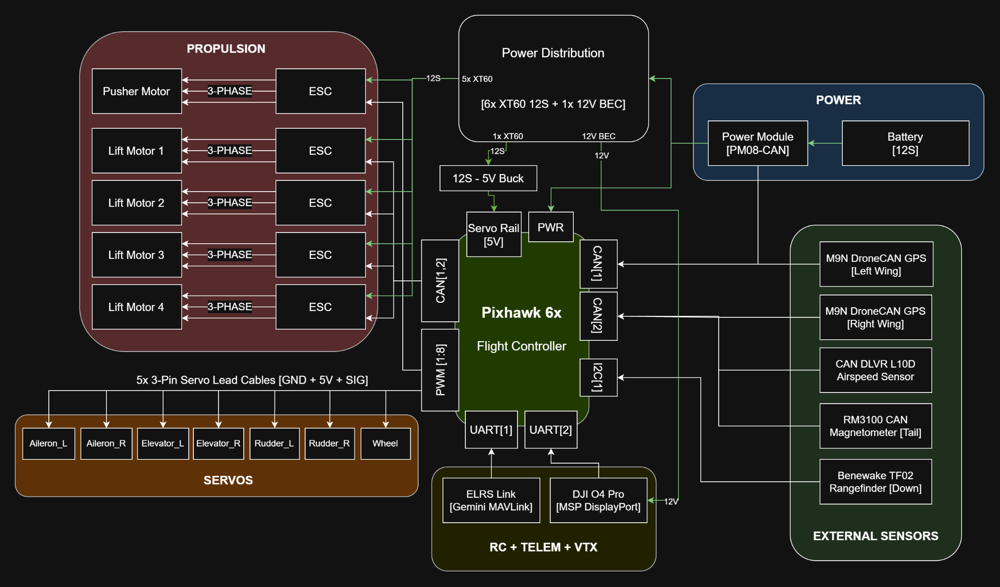

# Helios Mk II Harness Tracker

The Waterloo Aerial Robotics Group (WARG) uses this tracker to build and inspect the wiring harness for its Helios Mk II hybrid VTOL. Each wire run has a register entry with its endpoints, connector or wire specification, length in millimetres, and the names of the person who soldered it and the person who inspected it.

**[Open the live harness tracker](https://helios-mk2-harness-tracker.courteousstrawberry2.chatgpt.site/)**

## Using the wire register

Each run has four independent checkboxes, shown in build order: **Length final → Soldered → Mech ready → Installed**. Use **Filter** to combine checked or unchecked stages with inspection status. For example, select **Soldered · Checked** and **Installed · Unchecked** to find soldered runs awaiting installation.

Anyone can view the register and diagrams. Select **Log in to edit** to update a wire’s details or progress, add a run to a functional group, or remove and restore runs.

## Finding a wire on the diagrams

- **Functional overview** groups the wiring into Power, Power Distribution, Propulsion, Flight Controller, Servos, RC + TELEM + VTX, and External Sensors. Hover over a group to see its completed and total active runs for each stage. Click to open that group in the register. On a phone, tap once for counts and again to open the group.
- **Detailed harnessing** shows individual runs. Hover over a mapped wire to preview its four stage statuses, or click or tap to jump to its register entry. Runs on either side of a disconnect can have separate entries and progress.

## Project layout

The tracker uses TypeScript and React with Vinext on Cloudflare Workers. Wire records are stored in Cloudflare D1 through Drizzle ORM.

| Path | Purpose |
| --- | --- |
| [app/tracker.tsx](app/tracker.tsx) | Wire register, editor, status filters, and diagram interactions |
| [lib/harnesses.ts](lib/harnesses.ts) | Functional groups, original wire catalog, and tracking fields |
| [lib/diagram-routes.ts](lib/diagram-routes.ts) | Maps detailed schematic paths to wire IDs |
| [public/](public/) | Functional and detailed schematic images |
| [app/api/](app/api/) | Wire record and editor session endpoints |
| [db/schema.ts](db/schema.ts) and [drizzle/](drizzle/) | Database schema and migrations |
